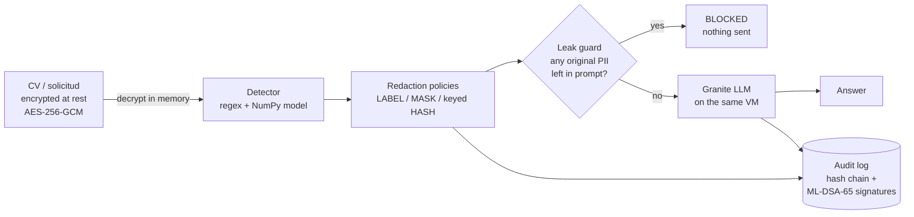
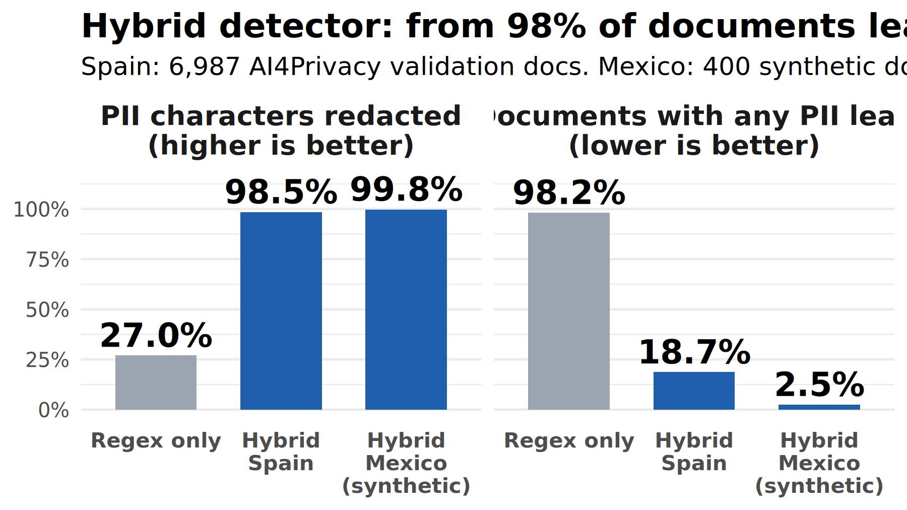

# Expediente Mínimo — PII redaction gateway on IBM LinuxONE

**El Squad del Desierto · IBM Z Datathon 2026 · Theme: AI Secured — Innovation Without Exposure**

HR teams in Ciudad Juárez paste CVs and job applications into AI assistants. Those
documents carry a candidate's CURP, RFC, NSS, phone, e-mail and home address. This
project is a gateway that runs on IBM LinuxONE and makes sure **no personal data ever
reaches the language model**, while every decision is recorded in an audit log that
auditors can verify years later, even against a future quantum computer.

---

## What it does



1. **Encryption at rest** — documents and the HMAC key are stored with AES-256-GCM (`src/vault.py`). Plaintext only exists in memory.
2. **Detection** — strict regex for CURP, RFC and e-mail, rules for Mexican names, phones, NSS/INE, dates and addresses, plus a token classifier written in pure NumPy, so it runs natively on s390x (`src/hybrid_detection.py`, `src/token_classifier.py`).
3. **Redaction** — per-type policies; pseudonyms use keyed HMAC-SHA-512, never a plain hash (`src/policies.py`, `src/redaction.py`).
4. **LLM gateway** — only redacted text is sent; the request is refused if any detected span is still present (`src/llm_gateway.py`). Granite runs locally on the VM through llama.cpp, so data never leaves the machine.
5. **Tamper-evident audit** — every redaction and LLM call is a hash-chained entry signed with **ML-DSA-65 (FIPS 204)**, containing hashes and counts only, never PII (`src/audit.py`, `src/signers.py`).

## Run it

On the LinuxONE VM (Ubuntu 24.04, s390x, Python 3.12):

```bash
python3 -m unittest discover -s tests                    # full test suite
python3 -m src.token_classifier --max-docs 30000         # train the detector model (~1m17s on s390x)
python3 -m src.demo                                      # end-to-end demo, mock LLM
LLM_BACKEND=llamacpp PII_SIGNER=ml-dsa-65 PII_MLDSA_KEY_DIR=keys \
  python3 -m src.demo                                    # real Granite + ML-DSA signatures
```

Reproduce everything (tests, Spanish and Mexican evaluation): `bash run_all.sh`
(prerequisites: trained model in `models/`, `data/processed/` present; reports are not overwritten
unless `OVERWRITE_REPORTS=1`).

Web UI for the demo: `streamlit run app/ui.py -- --server.port 8501` (see [`docs/UI.md`](docs/UI.md)).
Optional CURP/RFC checks against external providers are **off by default** and need both an API key
and `ENABLE_UNVERIFIED_EXTERNAL_CHECKS=1`; leave them off, since they would send identifiers off the
machine (see [`docs/SYSTEM_VERIFICATION.md`](docs/SYSTEM_VERIFICATION.md)).

ML-DSA needs liboqs once: `bash scripts/setup_mldsa.sh`, then
`python3 -m src.audit keygen --signer ml-dsa-65 --out keys`. Without it the audit log falls back
to HMAC-SHA-512 (same code path, `PII_SIGNER=hmac`).

Other entry points: `python3 -m src.evaluation --detector regex|ml|hybrid`,
`python3 -m src.audit verify --log <file>`, `python3 -m src.vault encrypt|check|info`.

## Results



Detector operating point `PII_O_THRESHOLD=0.85` (`src/config.py`), chosen to favour recall:
a missed CURP costs more than an over-redacted word. All numbers measured on LinuxONE s390x.

**Mexican documents** — 400 synthetic CVs / job applications with valid-format CURP, RFC, NSS,
INE, Mexican phones and Juárez addresses (`data/synthetic/mx_eval.jsonl`):

| | Before Mexican rules (A5) | **Final (hybrid, 0.85)** |
|---|---|---|
| PII characters redacted | 85.1 % | **99.8 %** |
| Documents with any leaked character | 100 % | **2.5 %** |
| Leak rate: CURP · e-mail · phone · names · addresses | 0 · 0 · 21 % · 82 % · 100 % | **0 · 0 · 0 · 0 · 0** |

The only remaining Mexican leaks are RFCs inside CV lines (3.8 % of documents with an RFC).
Details: [`reports/metrics_mx.json`](reports/metrics_mx.json), chart `07_mx_before_after.png`.

**Generic Spanish benchmark** — 6,987 synthetic ai4privacy validation documents (Spain conventions):

| Detector | PII characters redacted | Documents with any leaked character |
|---|---|---|
| Regex baseline | 27.0 % | 98.2 % |
| **Hybrid (regex + Mexican rules + NumPy model)** | **98.5 %** | **18.7 %** |

Per type (hybrid, overlap F1): e-mail 0.98 · demographic 0.95 · ID numbers 0.94 · dates 0.93 ·
addresses 0.88 · usernames 0.87 · phone 0.86 · names 0.83 · passwords 0.75.
The leak rate is strict: one missed character anywhere counts the whole document as leaked.
Passwords (28 %) and usernames (12 %) are the weakest types.

### Operating point (detection threshold)

| Threshold | Spain leak | Spain precision | MX leak | MX precision |
|---|---|---|---|---|
| 0.5 | 37.9 % | 0.893 | 7.2 % | 0.800 |
| 0.7 | 26.5 % | 0.870 | 3.7 % | 0.786 |
| **0.85** | **18.7 %** | **0.831** | **2.5 %** | **0.698** |
| 0.95 | 12.4 % | 0.732 | 3.0 % | 0.591 |

End-to-end sweep: [`reports/threshold_sweep.json`](reports/threshold_sweep.json), chart `08_threshold_sweep.png`.
Override with the `PII_O_THRESHOLD` environment variable.
Model details, data, false-positive types and safeguards: **[model card, `docs/MODEL.md`](docs/MODEL.md)**.

**End-to-end demo on LinuxONE** (`python3 -m src.demo`, Granite + ML-DSA-65):

- CV encrypted at rest; no plaintext in the file
- prompt contains no original CURP, RFC or e-mail
- audit log VALID; edit one entry in a copy → signature INVALID + hash chain broken
- 26–34 s end to end, almost all of it the LLM

**Cost of security**: 12,055 redactions/s with signed audit vs 46,787/s without (HMAC, regex detector) — about 0.06 ms per entry.
Training and evaluation timings: [`reports/timing_s390x.md`](reports/timing_s390x.md). Charts: [`reports/figures/`](reports/figures/).

## IBM Z security, what is real and what is not

| Capability | Status in this prototype | Evidence |
|---|---|---|
| CPACF on-chip crypto (AES, SHA-2) | **Used** via OpenSSL; AES-256-GCM at ~15 GB/s | [`reports/evidence/ibmz_crypto_s390x.txt`](reports/evidence/ibmz_crypto_s390x.txt) |
| ML-DSA-65 signatures (NIST FIPS 204) | **Running** on s390x via liboqs | demo output, `docs/CRYPTO_INVENTORY.md` |
| AES-256-GCM encryption at rest | **Running** | `python3 -m src.vault info` |
| On-platform LLM inference | **Running** (Granite via llama.cpp on the VM) | demo output |
| Crypto Express HSM | Not available on Community Cloud | `lszcrypt`: no crypto card devices |
| Telum on-chip AI accelerator | Not used (NumPy model runs on CPU) | — |

Full crypto inventory with quantum status: [`docs/CRYPTO_INVENTORY.md`](docs/CRYPTO_INVENTORY.md).
Machine-readable CycloneDX 1.6 CBOM: [`docs/CBOM.json`](docs/CBOM.json).
Benchmark against the IBM Redbook (Tables 1-1, 2-1, 2-3, 2-4, 6-1): `python3 scripts/qs_benchmark.py && Rscript r/plot_qs_benchmark.R` → [`reports/qs_benchmark.json`](reports/qs_benchmark.json), charts 09–14.
Key handling and repository hygiene: [`docs/SECURITY.md`](docs/SECURITY.md). Tests and CI: [`docs/TESTING.md`](docs/TESTING.md).

## Path to production

Following IBM Redbook SG24-8525 (*Transitioning to Quantum-Safe Cryptography on IBM Z*) and the AI Toolkit for IBM Z:

| Prototype | Production on IBM Z / LinuxONE |
|---|---|
| ML-DSA via liboqs in software | ICSF CCA / EP11 with **Crypto Express8S**; dual classical + ML-DSA signatures |
| AES-256-GCM file vault | **Pervasive encryption** of data sets, keys in the HSM |
| Python process on a shared VM | **IBM Secure Execution** for Linux (isolated, encrypted guest) |
| NumPy token classifier | Export to ONNX → **IBM zDLC** / Triton on the **Telum** AI accelerator |
| Granite via llama.cpp | Granite served on-platform (AI Toolkit containers) so documents never leave Z |
| Audit log file + printed head hash | Head hash anchored in a second system; log in tamper-protected storage |

## Limitations

- Training and validation data are synthetic Spain-Spanish documents. Mexican identifiers are covered by regex and a 400-document synthetic Mexican set (`data/synthetic/mx_eval.jsonl`); no real personal data was used anywhere.
- The detector still misses some PII: 2.5 % of Mexican test documents and 18.7 % of the generic Spanish benchmark keep at least one character. Precision on Mexican documents is 0.70, so it over-redacts some ordinary words; that is the deliberate trade-off. The leak guard blocks only what the detector found, so it complements, not replaces, better detection.
- Deleting entries from the **end** of the audit log is only detectable against the externally recorded head hash.
- This is a privacy-protection gateway, not an identity or credential verification system.

## Repository

```
src/        detection, redaction, gateway, audit, vault, demo
tests/      unit tests (run on s390x)
scripts/    setup_mldsa.sh, metrics export, Mexican synthetic data tools
data/       synthetic data only (raw ai4privacy files are downloaded, never committed)
docs/       CRYPTO_INVENTORY.md, CBOM.json, MODEL.md
reports/    metrics JSON, timings, figures (R / ggplot2 in r/)
notebooks/  exploration and baseline notebooks
```

**Data**: [ai4privacy/pii-masking-300k](https://huggingface.co/datasets/ai4privacy/pii-masking-300k) (Spanish split, synthetic) plus our own synthetic Mexican documents. Keys, `.pem` files, models and raw data are gitignored.
